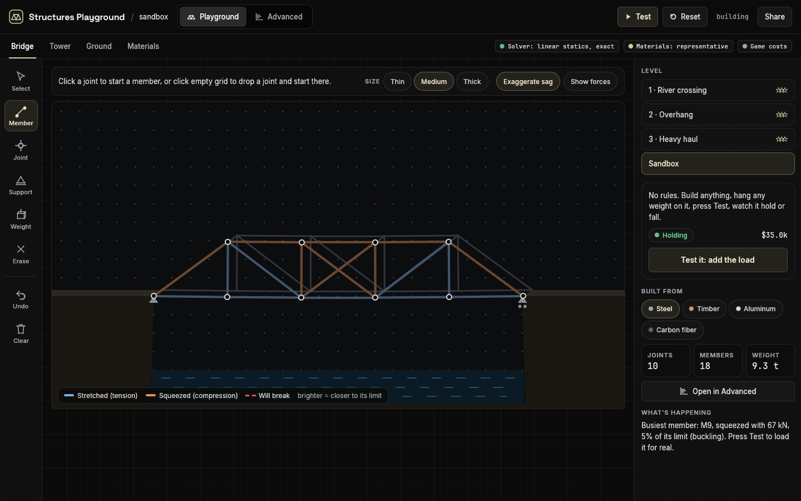
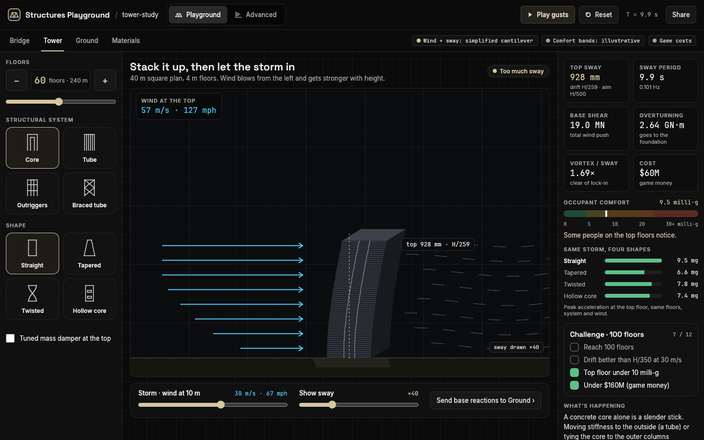
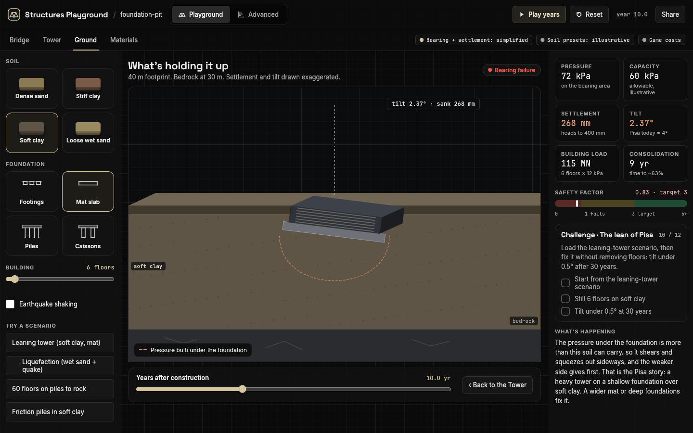
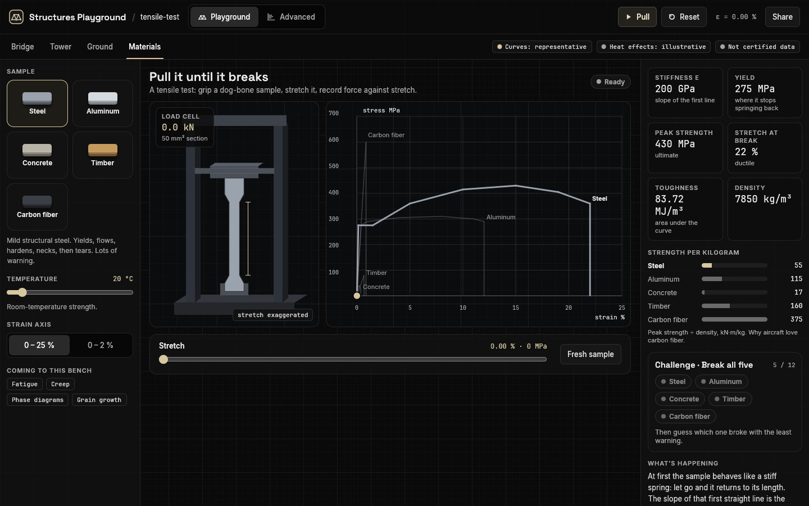
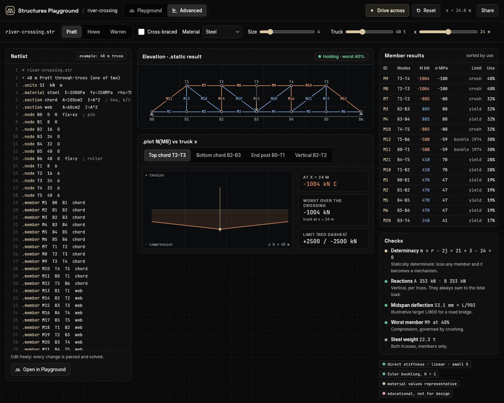
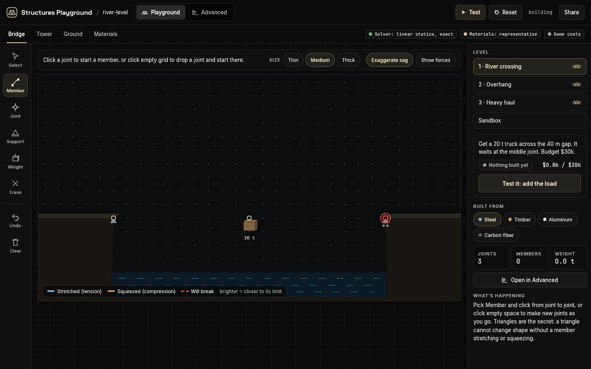
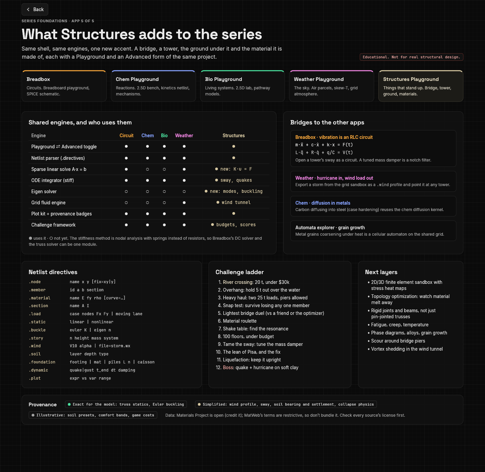

<p align="center">

</p>
<h1 align="center">Structures Playground</h1>
<p align="center"><b>SPICE for things that stand up.</b><br>Build a bridge and break it, stack a skyscraper into a storm, set it on soft clay, pull materials until they snap — and read the same bridge as a truss netlist with stiffness results and an influence line. One native macOS app, written in Rust.</p>
<p align="center"></p>

> **Educational. Not for real structural design.** The models are exact for what they model
> (linear truss statics, Euler buckling) or deliberately simplified (wind, sway, soil, collapse
> physics), and every screen says which with its provenance badges.

## What is it?

Structures Playground is the fifth bench in the **lab series** ("SPICE for X"), next to
Breadbox (circuits), Chem Playground (reactions), Automata Playground (cellular automata) and
the planned Bio and Weather playgrounds. It shares their greys, graph-paper ground, header and
fonts, and adds one sand accent, the force colours (tension blue, compression orange, "will
break" red) and a structural engine.

- **Playground** — four worlds you play with: the **Bridge** (draw a truss across a river,
  hang weights on it and Test it until it holds or collapses), the **Tower** (a skyscraper in
  a storm: sway, vortex lock-in, comfort), the **Ground** (soils and foundations: settlement,
  tilt, liquefaction, the lean of Pisa) and **Materials** (a tensile test on five materials,
  hot or cold).
- **Advanced** — the bridge as a **truss netlist**: an editable `.str` text (with Pratt / Howe
  / Warren generators), the elevation coloured by force, a member's influence line as the
  truck crosses, the member results table and the checks.

Every number on screen comes from the engine (`sp-engine`); each mockup's own JavaScript is
re-run in Node and its numbers are reproduced exactly as golden tests.

## A quick tour

<table>
<tr><td width="50%"><br><sub><b>Tower</b> — floors, system, shape, a tuned mass damper; sway, drift, period, lock-in, comfort.</sub></td><td width="50%"><br><sub><b>Ground</b> — soil and foundation, the pressure bulb, settlement and tilt over 30 years.</sub></td></tr>
<tr><td><br><sub><b>Materials</b> — the tensile rig and the stress–strain curve for steel, aluminum, concrete, timber, carbon fiber.</sub></td><td><br><sub><b>Advanced</b> — the netlist, the elevation, the influence line, member results and checks.</sub></td></tr>
<tr><td><br><sub><b>Bridge</b> — level 1 · River crossing: 20 t at the middle joint, a $30k budget.</sub></td><td><br><sub><b>Series</b> — what Structures adds to the lab series; open a sibling app from here.</sub></td></tr>
</table>

## Features

**Bridge** (Playground)
- A 1120 × 600 stage on a 2 m snap grid: two banks, a 40 m river, members drawn 2.5D as round
  capped bars, coloured by force from a live solve (tension blue / compression orange, brighter
  closer to the limit, dashed red past it, grey when carrying almost nothing) and drawn
  displaced (×40 "Exaggerate sag").
- Tools: Select (inspect, drag joints), Member, Joint, Support (pin / roller), Weight (1–25 t
  steps up to 200 t), Erase, Undo (40 steps), Clear; Thin / Medium / Thick members; Steel,
  Timber, Aluminum or Carbon fiber.
- Four levels — River crossing, Overhang, Heavy haul and the Sandbox (with a starter truss) —
  with their budgets and placement rules; cost and stars (≤ budget, ≤ 75 %, ≤ 55 %), best stars
  remembered.
- **Test**: the load ramps to 100 %, members past their limit snap / buckle / crush one after
  another and the load redistributes; it holds, or the structure collapses in a
  position-based-dynamics simulation (tearing members, sparks, water drag), with a slow-motion
  replay.
- The inspector (a member's length, force, utilisation and limit in plain words; a joint's
  supports and weights), "What's happening", keyboard editing (arrow keys move a joint,
  Delete, ⌘Z), Share as a `.str` netlist, paste one with ⌘V, "Open in Advanced".

**Tower** (Playground)
- 5–120 floors, Core / Tube / Outriggers / Braced tube, Straight / Tapered / Twisted / Hollow
  core, a tuned mass damper; storm wind at 10 m.
- The model (simplified cantilever): power-law wind, floor forces, top sway and drift (aim
  H/500), first-mode period, vortex shedding and lock-in, peak acceleration in milli-g against
  comfort bands, base shear, overturning moment, cost.
- **Play gusts**: the first mode as a damped oscillator (a two-degree-of-freedom tuned mass
  with the damper) driven by seeded gusts, Newmark-integrated; the tower sways and the damper
  swings against it.
- "Same storm, four shapes", the 100-floor challenge, and "Send base reactions to Ground ›".

**Ground** (Playground)
- Dense sand, stiff clay, soft clay, loose wet sand; footings, a mat slab, piles (to bedrock at
  30 m) or caissons; building floors; earthquake shaking; four scenarios (the leaning tower,
  liquefaction, 60 floors on piles to rock, friction piles in soft clay).
- Pressure, capacity, safety factor against its target, settlement with consolidation over
  the years, differential settlement as tilt (Pisa ≈ 4°), liquefaction; **Play years** runs 30
  years of settling. The Pisa challenge, and "‹ Back to the Tower".

**Materials** (Playground)
- The tensile machine in 2.5D: a dog-bone sample stretches, necks and tears; a load cell and
  an extensometer.
- Representative curves for five materials, a temperature from −40 to 600 °C, a 0–25 % or
  close-up 0–2 % strain axis; **Pull** stretches it until it breaks.
- Stiffness, yield, peak strength, stretch at break, toughness, density; strength per kilogram;
  the "Break all five" challenge.

**Advanced**
- The netlist (`.str`) is the source of truth: a line-numbered editor with syntax colours,
  every edit re-parsed and re-solved; errors marked on their line with the last good result
  dimmed.
- The toolbar regenerates it: Pratt / Howe / Warren, cross-braced, material, size, truck
  weight and position; **Drive across** moves the truck along the deck.
- The elevation (forces coloured, labels, supports, the truck), the influence line of a picked
  member with its limit dashes, the member table sorted by use (force, stress, limit, use %),
  and the checks: determinacy m + r − 2j, reactions, midspan deflection, worst member, weight.
- Round trip with the Bridge: its structure opens here as a netlist with the same forces to
  the newton, and a netlist on the grid opens back in its Sandbox.

**Everywhere**: the header (brand → Series, Playground / Advanced, each screen's drive button,
Reset, clock, Share), provenance badges on every world, ⌘1–⌘4 worlds, ⌘5 Advanced, Space
presses the drive button, Tab / Shift-Tab through every control; every control is an AccessKit
button, link, tab, slider, checkbox or text field with a name, and every stage describes
itself; columns stack and the page scrolls on narrow windows (down to 390 px); the window
remembers its size and the last screen; nothing animates at rest (0 % CPU when idle).

## Run

```sh
cd structures-playground                 # next to ../labkit in the lab-series folder
export PATH="$HOME/.cargo/bin:$PATH"     # rustup's toolchain, not an older Homebrew rustc
cargo run --release -p structures-playground
```

Or build the app bundle: `scripts/bundle-macos.sh` → `dist/Structures Playground.app` (with
`structures-mcp` inside; add `--dmg` for a disk image, `--check` to verify it). macOS on Apple
Silicon is what's built and tested; you need [Rust via rustup](https://rustup.rs)
(`rust-toolchain.toml` selects stable) and the shared `labkit` crates (theme, UI, MCP) checked
out next to this folder (`../labkit`).

`structures-playground --smoke 3` opens the Bridge, presses Test, runs for three seconds and
prints a one-line report (start-up time, frames); `--headless` does it without a window.
Double-clicking a `.str` netlist opens it in Advanced.

## Test

```sh
scripts/test-all.sh            # fmt, shellcheck, clippy -D warnings, every test, perf gates, bundle
scripts/test-all.sh --quick    # without the release perf gates and the bundle
```

The suite has engine unit, golden and property tests (the mockups' JavaScript re-run for their
numbers; closed forms for the solver and the oscillators; seeded fuzzing of the netlist
parser), GUI tests that drive every screen with `egui_kittest` through AccessKit, end-to-end
journeys across screens (`crates/structures-playground/tests/journeys.rs`), closeness bounds
against the mockup's references, frame-pacing tests, and MCP tests that spawn the real server.
To look at the app next to the mockup:

```sh
scripts/compare-mockup.sh tower    # target/compare/<Screen>-1440.png / -390.png, [app | mockup]
scripts/screenshots.sh             # re-renders docs/screenshots/*.png
```

## MCP server

`structures-mcp` lets AI agents solve structures headless — `solve_truss` (a netlist →
reactions, member forces, utilisation, failure modes, determinacy), `influence_line`,
`tower_wind`, `ground_check`, `tensile_test` — and look at and drive the running app: status,
navigate, screenshot, describe, load a netlist into the Bridge and Test it, set the Tower, the
Ground and the Materials bench. See [`crates/sp-mcp/README.md`](crates/sp-mcp/README.md) for
building it and adding it to Claude Code or Claude Desktop:

```sh
cargo build --release -p sp-mcp
claude mcp add structures-playground -- "$PWD/target/release/structures-mcp"
```

## Project layout

```
crates/
  sp-engine/             the engine, no UI: the truss stiffness solver and member checks; the
                         Bridge game (levels, editing, the Test, the collapse simulation); the
                         .str netlist parser / writer, generators and influence lines; tower wind
                         and sway, dynamics (RK4, Newmark, gusts, tuned mass dampers); ground;
                         materials
  sp-theme/              Structures' tokens (the sand accent, force and status colours, material
                         swatches, sizes) on top of labkit's lab-theme, one module per screen
  structures-playground/ the egui app: header, router, layout, widgets, the six screens, the MCP
                         bridge, --smoke; tests/ has the GUI suites and the journeys
  sp-shared/, sp-mcp/    the MCP vocabulary and the structures-mcp server
docs/                    ARCHITECTURE.md (crate contracts), DATA-SOURCES.md (every constant and
                         its provenance), the design mockup and its references, screenshots
scripts/                 test-all, bundle-macos / check-bundle, compare-mockup, screenshots,
                         render-mockup.mjs, mockup-goldens.mjs
```

[`SPEC.md`](SPEC.md) is the definition of done (every requirement has an ID the tests cite),
[`docs/ARCHITECTURE.md`](docs/ARCHITECTURE.md) the map of the code,
[`docs/DATA-SOURCES.md`](docs/DATA-SOURCES.md) where every material, soil, wind and cost
constant comes from (exact, simplified or illustrative), and [`PROGRESS.md`](PROGRESS.md) the
work log.

## The lab series

Each bench is a playground on top of a serious engine: Breadbox puts a SPICE engine under a
breadboard, Chem Playground a reaction-kinetics engine under a glassware bench, Automata
Playground an exact cellular-automata engine under a Petri tray, and Structures Playground a
stiffness-method solver under a bridge you can break. The stiffness method is nodal analysis
with springs instead of resistors, so the truss solver and Breadbox's DC solver are the same
idea. They share [`labkit`](../labkit) (fonts and egui style, layout maths and graph-paper
ground, the MCP server and live bridge), a look and the Playground / Advanced split.

## License

MIT. The bundled fonts (Inter, JetBrains Mono, Space Grotesk, via labkit) are under the SIL
Open Font License 1.1.
