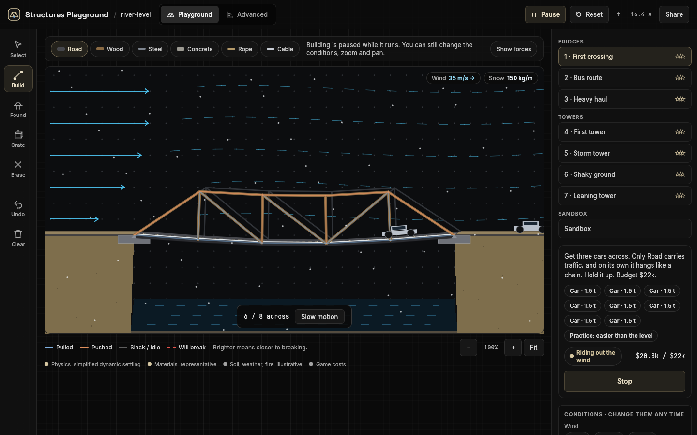
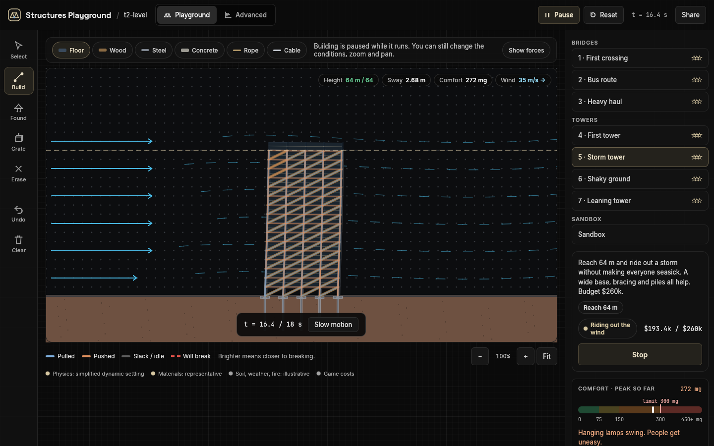
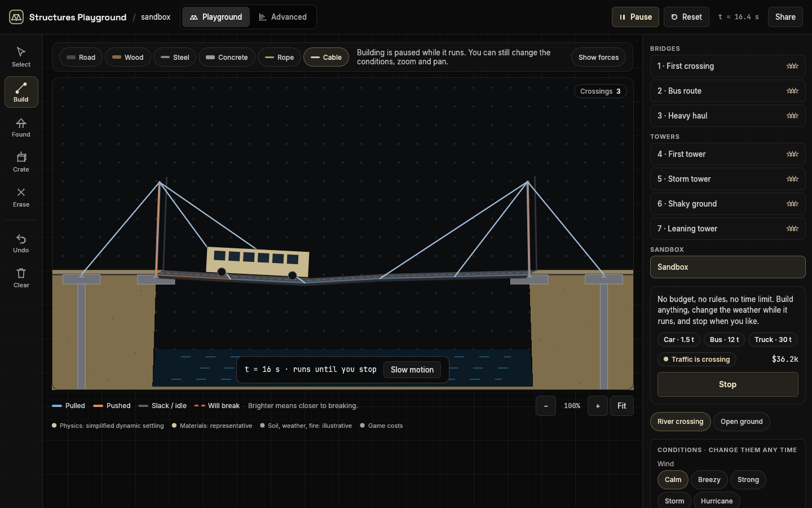
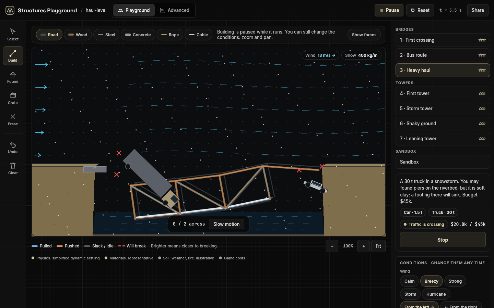
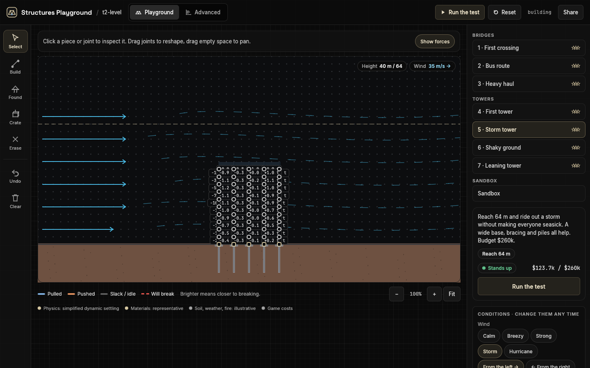

<p align="center">

</p>
<h1 align="center">Structures Playground</h1>
<p align="center"><b>SPICE for things that stand up.</b><br>Build a bridge or a tower piece by piece, put it on real soil, then send trucks across in a snowstorm, shake it, set it on fire and fast-forward thirty years — and read a truss as a netlist with stiffness results and an influence line. One native macOS app, written in Rust.</p>
<p align="center"></p>

> **Educational. Not for real structural design.** The models are exact for what they model
> (linear truss statics, Euler buckling) or deliberately simplified (the settling engine, wind,
> soil, fire), and the app says which on every screen (its provenance line and badges).

## What is it?

Structures Playground is the fifth bench in the **lab series** ("SPICE for X"), next to
Breadbox (circuits), Chem Playground (reactions), Automata Playground (cellular automata) and
the planned Bio and Weather playgrounds. It shares their greys, graph-paper ground, header and
fonts, and adds one sand accent, the force colours (pulled blue, pushed orange, "will break"
red) and a structural engine.

- **Playground** — one **builder** for bridges and towers. Draw pieces (road, floor, wood,
  steel, concrete, rope, cable) joint to joint, put footings or piles on the soil, hang crates,
  and watch the live preview settle: every piece coloured by how hard it is pulled or pushed.
  Then **run** it — cars, buses and trucks across a river, or a tower through wind, snow and
  earthquakes — on one settling engine, where pieces snap, buckle and crush and foundations
  sink, rip out or liquefy. Seven levels with budgets and stars, and a Sandbox. Folded in from
  the first version: the **comfort meter** and "same storm, four shapes", **thirty years of
  settlement** with a Leaning tower level, the **sample lab** (pull or push any piece type to
  breaking) and **fire**.
- **Advanced** — a truss as a **netlist**: an editable `.str` text (with Pratt / Howe / Warren
  generators), the elevation coloured by force, a member's influence line as the truck
  crosses, the member results table and the checks. The builder opens its structure here, and
  a netlist goes back into the Sandbox.

Every number on screen comes from the engine (`sp-engine`); the mockups' own JavaScript is
re-run in Node and their numbers are reproduced as golden tests.

## A quick tour

<table>
<tr><td width="50%"><br><sub><b>Storm tower</b> — 64 m in a 35 m/s storm: sway, comfort in milli-g against the level's limit, the comfort meter.</sub></td><td width="50%"><br><sub><b>Sandbox</b> — a cable-stayed deck between two steel pylons on piles; traffic loops and counts its crossings.</sub></td></tr>
<tr><td><br><sub><b>Heavy haul</b> — a wood truss under a 30 t truck in a snowstorm: what breaks first, and why.</sub></td><td><br><sub><b>Building</b> — the live preview with "Show forces": the force in tonnes on every piece, the status and the cost against the budget.</sub></td></tr>
<tr><td><br><sub><b>Advanced</b> — the netlist, the elevation, the influence line, member results and checks.</sub></td><td><br><sub><b>Series</b> — what Structures adds to the lab series; open a sibling app from here.</sub></td></tr>
</table>

## Features

**The builder** (Playground)
- A 1120 × 600 stage in world metres: a river crossing (banks, a 40 m river, riverbed) or open
  ground; zoom 35–500 % (wheel, buttons, ⌘= / ⌘− / ⌘0 fit), pan by dragging or the arrow keys;
  a 2 m / 4 m snap grid that refines as you zoom in.
- Tools: Select (inspect, drag joints), Build (chain pieces joint to joint, "Finish line"),
  Found (footing or pile), Crate (1 / 5 / 10 / 25 t), Erase, Undo (40 steps), Clear. Seven
  piece types with their own stiffness, strength, buckling, weight, cost and maximum length;
  rope and cable only pull and sag when slack; road and floor are 2.5D decks.
- **Live preview**: every edit settles the structure headless (pulled blue / pushed orange,
  brighter closer to breaking, dashed red past it); joints that sag and overloaded foundations
  are ringed; "Show forces" puts tonnes on every piece; the status says whether it stands.
- **Running**: vehicles drive on road pieces with their axle loads; wind with gusts and vortex
  shedding, snow piling up on decks, earthquakes ("Shake now"), fire ("Light it now"); soils
  from rock to loose wet sand; pieces snap, crack, buckle, crush, soften or burn through;
  foundations sink, rip out or liquefy. Slow motion, a result banner with stars, "Replay in
  slow motion".
- Levels — First crossing, Bus route, Heavy haul (bridges); First tower, Storm tower, Shaky
  ground, Leaning tower (towers) — with budgets (stars at ≤ budget, ≤ 80 %, ≤ 60 %, best stars
  remembered) and practice runs when you make the weather easier; the Sandbox (no rules; river
  or open ground; looping traffic).
- The inspector (a piece's force and limit in plain words, a joint's foundation and crate, the
  soil's capacity), "What's happening", Share as a `.str` netlist, paste one with ⌘V, "Open in
  Advanced".
- **Comfort** (CMF): the meter in milli-g with its bands and the level's limit; "Compare
  shapes" reruns the storm on your tower as built, tapered, twisted and hollow-cored.
- **Thirty years** (TIME): after a run that stood, each foundation consolidates into its soil;
  unequal settlement tilts the structure and the lean feeds itself; the Leaning tower level
  asks you to fix one with piles and a counterweight.
- **Sample lab** (LAB) and **fire** (FIRE): each Materials card opens a tensile rig with that
  piece type's stress–strain curve; pull or push it to breaking, at up to 900 °C, against the
  force the same piece breaks at in the builder; fire heats nearby pieces with the published
  steel and concrete reduction factors.

**Advanced**
- The netlist (`.str`) is the source of truth: a line-numbered editor with syntax colours,
  every edit re-parsed and re-solved; errors marked on their line with the last good result
  dimmed.
- The toolbar regenerates it: Pratt / Howe / Warren, cross-braced, material, size, truck
  weight and position; **Drive across** moves the truck along the deck.
- The elevation (forces coloured, labels, supports, the truck), the influence line of a picked
  member with its limit dashes, the member table sorted by use (force, stress, limit, use %),
  and the checks: determinacy m + r − 2j, reactions, midspan deflection, worst member, weight.
- Round trip with the builder: its structure opens here as a netlist (one `.material` per
  piece type, foundations as supports, crates as loads), and a netlist on the grid opens back
  in its Sandbox.

**Everywhere**: the header (brand → Series, Playground / Advanced, the screen's drive button,
Reset, clock, Share), ⌘1 Playground, ⌘2 Advanced, Space presses the drive button, Tab /
Shift-Tab through every control; every control is an AccessKit button, link, slider, checkbox
or text field with a name (joints and pieces too), and the stage describes itself; columns
stack and the page scrolls on narrow windows (down to 390 px); the window remembers its size
and the last screen; nothing animates at rest (0 % CPU when idle).

## Run

```sh
git clone https://github.com/alexwhb/lab-structures && cd lab-structures
export PATH="$HOME/.cargo/bin:$PATH"     # rustup's toolchain, not an older Homebrew rustc
cargo run --release -p structures-playground
```

Or build the app bundle: `scripts/bundle-macos.sh` → `dist/Structures Playground.app` (with
`structures-mcp` inside; add `--dmg` for a disk image, `--check` to verify it). macOS on Apple
Silicon is what's built and tested; you need [Rust via rustup](https://rustup.rs)
(`rust-toolchain.toml` selects stable). Cargo fetches the shared
[labkit](https://github.com/alexwhb/labkit) crates (theme, UI, MCP) from GitHub at the commit
pinned in `Cargo.toml`.

`structures-playground --smoke 3` opens the Playground on level 1 with a wood truss, presses
"Run traffic", runs for three seconds and prints a one-line report (start-up time, frames);
`--headless` does it without a window.
Double-clicking a `.str` netlist opens it in Advanced.

## Test

```sh
scripts/test-all.sh            # fmt, shellcheck, clippy -D warnings, every test, perf gates, bundle
scripts/test-all.sh --quick    # without the release perf gates and the bundle
```

The suite has engine unit, golden and property tests (the mockups' JavaScript re-run for their
numbers, the builder's settling engine bit for bit; closed forms for the solver and the
oscillators; seeded fuzzing of the netlist parser), GUI tests that drive every screen with
`egui_kittest` through AccessKit, end-to-end journeys (`crates/structures-playground/tests/
journeys.rs`: level 1 built by clicks and run, a collapse and its replay, Open in Advanced,
keyboard-only building and zoom, …), closeness bounds against the mockup's references,
frame-pacing tests, and MCP tests that spawn the real server. To look at the app next to the
mockup:

```sh
scripts/compare-mockup.sh playground  # target/compare/<Screen>-1440.png / -390.png, [app | mockup]
scripts/screenshots.sh                # re-renders docs/screenshots/*.png (and the builder boards)
```

## MCP server

`structures-mcp` lets AI agents work headless — `builder_test` (a level + a structure as a
netlist + conditions → run to the end → the result, what broke first, comfort, stars, and the
settlement over the years), `solve_truss` (a netlist → reactions, member forces, utilisation,
failure modes, determinacy), `influence_line`, and the v1 models `tower_wind`, `ground_check`,
`tensile_test` — and look at and drive the running app: status, navigate, screenshot,
describe, pick a level, load a netlist into the Sandbox, change the conditions, run it,
fast-forward thirty years, test a sample. See [`crates/sp-mcp/README.md`](crates/sp-mcp/README.md) for
building it and adding it to Claude Code or Claude Desktop:

```sh
cargo build --release -p sp-mcp
claude mcp add structures-playground -- "$PWD/target/release/structures-mcp"
```

## Project layout

```
crates/
  sp-engine/             the engine, no UI: the truss stiffness solver and member checks; the
                         builder (pieces, soils, levels, editing, the settling engine, comfort,
                         settlement over the years, the sample lab, fire); the .str netlist
                         parser / writer, generators and influence lines; the v1 tower, dynamics,
                         ground and materials models
  sp-theme/              Structures' tokens (the sand accent, force and status colours, material
                         swatches, sizes) on top of labkit's lab-theme, one module per screen
  structures-playground/ the egui app: header, router, layout, widgets, the three screens (the
                         builder, Advanced, Series), the MCP bridge, --smoke; tests/ has the GUI
                         suites and the journeys
  sp-shared/, sp-mcp/    the MCP vocabulary and the structures-mcp server
docs/                    ARCHITECTURE.md (crate contracts), DATA-SOURCES.md (every constant and
                         its provenance), the design mockups (v2: the builder) and their
                         references, screenshots
scripts/                 test-all, bundle-macos / check-bundle, compare-mockup, screenshots,
                         render-mockup(-v2).mjs, mockup-goldens.mjs
```

[`SPEC.md`](SPEC.md) is the definition of done (every requirement has an ID the tests cite),
[`docs/ARCHITECTURE.md`](docs/ARCHITECTURE.md) the map of the code,
[`docs/DATA-SOURCES.md`](docs/DATA-SOURCES.md) where every material, soil, wind and cost
constant comes from (exact, simplified or illustrative), and [`PROGRESS.md`](PROGRESS.md) the
work log.

## The lab series

Each bench is a playground on top of a serious engine: Breadbox puts a SPICE engine under a
breadboard, Chem Playground a reaction-kinetics engine under a glassware bench, Automata
Playground an exact cellular-automata engine under a Petri tray, and Structures Playground a
settling engine and a stiffness-method solver under bridges and towers you can break. The stiffness method is nodal analysis
with springs instead of resistors, so the truss solver and Breadbox's DC solver are the same
idea. They share [`labkit`](https://github.com/alexwhb/labkit) (fonts and egui style, layout
maths and graph-paper ground, the MCP server and live bridge), a look and the Playground /
Advanced split.

| repo | what it is |
|---|---|
| [lab-breadbox](https://github.com/alexwhb/lab-breadbox) | Breadbox: breadboards, real Arduino firmware, a SPICE workbench |
| lab-chem | Chem Playground: glassware bench on a reaction-kinetics engine (not published yet) |
| [lab-automata](https://github.com/alexwhb/lab-automata) | Automata Playground: cellular automata on a 2.5D Petri tray |
| [lab-structures](https://github.com/alexwhb/lab-structures) | Structures Playground (this repo) |
| [labkit](https://github.com/alexwhb/labkit) | the shared crates |

## License

MIT (see [`LICENSE`](LICENSE)). The bundled fonts (Inter, JetBrains Mono, Space Grotesk, via labkit) are under the SIL
Open Font License 1.1.
